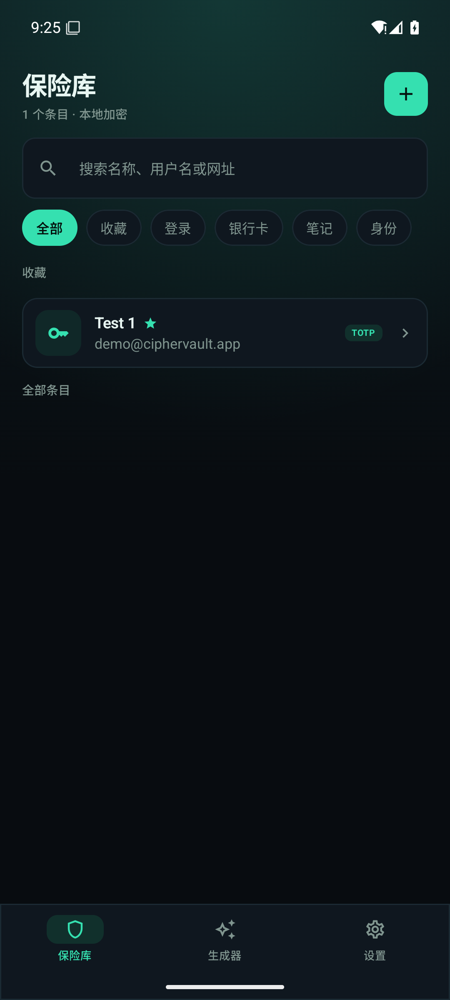

# CipherVault

**English** · [简体中文](README.md)

[](https://github.com/OWNER/CipherVault/actions/workflows/ci.yml)
[](https://github.com/OWNER/CipherVault/actions/workflows/release.yml)
[](LICENSE)


A local-first Android password manager with an encrypted vault, TOTP codes, password generator, biometric unlock, and system Autofill. No network access, no uploads, no cloud dependency.

The UI follows the **Obsidian Vault** direction: near-black surfaces, teal accents, and monospaced type for secrets.



## Features

- Master-password vault creation and unlock with Argon2id key derivation
- Fingerprint / face unlock (Android Keystore + CryptoObject)
- Four item types: login, card, secure note, identity
- Folders, favorites, search, trash
- Long-press quick actions: copy username / password / TOTP, pin, favorite, edit, move to trash; four list sort modes
- TOTP: manual secret, `otpauth://` URI, QR scan; 6/8 digits, SHA1/256/512, 30/60 seconds
- Offline security audit: weak passwords, reused passwords, missing TOTP
- Password generator: random passwords and passphrases
- Full-database encryption with SQLCipher
- Import/export: Bitwarden JSON, CSV, and an encrypted CipherVault backup
- Android Autofill for username, password, and TOTP; unlock-and-authenticate before filling
- Screenshot protection, clipboard auto-clear, auto-lock
- Chinese and English UI, switchable in Settings

> Roadmap and the v1.1 PRD live in [docs/PRODUCT-ROADMAP.md](docs/PRODUCT-ROADMAP.md) (Chinese).

## Download

Grab CI-built APKs from [GitHub Releases](https://github.com/OWNER/CipherVault/releases):

| File | Description |
| --- | --- |
| `CipherVault-<version>-release.apk` | R8 + resource shrinking, signed when signing secrets are configured |
| `CipherVault-<version>-release-unsigned.apk` | Same build without signing (when secrets are absent) |
| `CipherVault-<version>-debug.apk` | Unminified debug build for development comparison |
| `CipherVault-<version>-mapping.txt.gz` | R8 mapping file for deobfuscating crash stacks |
| `SHA256SUMS.txt` | SHA-256 checksums for the APKs above |

> This release has not undergone an independent security audit. Evaluate the risk before storing real credentials.

## Build

Requirements: JDK 17+ (tested with Temurin 21), Android SDK Platform 36, Build Tools 36.0.0.

```bash
git clone https://github.com/OWNER/CipherVault.git
cd CipherVault

# Debug
./gradlew :app:assembleDebug
adb install -r app/build/outputs/apk/debug/app-debug.apk

# Release (R8 + resource shrinking + v2/v3 signing)
./gradlew :app:clean :app:testReleaseUnitTest :app:lintRelease :app:assembleRelease
# Output: app/build/outputs/apk/release/app-release.apk
```

Release builds read `keystore.properties`, which is git-ignored. Without it the build still succeeds but produces an unsigned `app-release-unsigned.apk`:

```properties
storeFile=../keystore/release.jks
storePassword=<password>
keyAlias=ciphervault
keyPassword=<password>
```

Generate a signing key:

```bash
keytool -genkeypair -keystore keystore/release.jks -alias ciphervault \
  -keyalg RSA -keysize 2048 -validity 9125 -dname "CN=CipherVault Release Key"
```

> **Back up `keystore/` and `keystore.properties` immediately.** Losing them means you can no longer ship updates signed with the same key; installed users would have to uninstall and reinstall, losing vault data.

Tests:

```bash
./gradlew :app:testDebugUnitTest :app:testReleaseUnitTest
```

The R8 mapping file is written to `app/build/outputs/mapping/release/mapping.txt` and can be used with the Android SDK `retrace` tool:

```bash
$ANDROID_HOME/cmdline-tools/latest/bin/retrace --mapping mapping.txt crash.log
```

## Automated builds

Two GitHub Actions workflows ship with the repository:

| Workflow | Trigger | What it does |
| --- | --- | --- |
| [`ci.yml`](.github/workflows/ci.yml) | Push to `main` / pull requests | Unit tests, lint, debug APK build, artifact upload |
| [`release.yml`](.github/workflows/release.yml) | Push a `v*` tag | Derives the version from the tag, builds release/debug APKs, generates checksums and the mapping file, publishes a GitHub Release |

Cut a release:

```bash
git tag v1.1.0
git push origin v1.1.0
```

`versionName` comes from the tag (`1.1.0`) and `versionCode` is `major*10000 + minor*100 + patch`. You can override both locally:

```bash
./gradlew :app:assembleRelease -Pciphervault.versionName=1.1.0 -Pciphervault.versionCode=10100
```

For signed release artifacts, add `ANDROID_KEYSTORE_BASE64`, `ANDROID_KEYSTORE_PASSWORD`, `ANDROID_KEY_ALIAS`, and `ANDROID_KEY_PASSWORD` to the repository's Actions secrets. See [CONTRIBUTING.md](CONTRIBUTING.md) for details.

## Enabling Autofill

1. Open Settings → System → Languages & input → Autofill service
2. Select "CipherVault Autofill"
3. Tap a username or password field in any Autofill-aware app

While the vault is locked, tap the "Unlock to autofill" card and finish master-password or biometric authentication. If the fill panel does not reappear automatically, tap the password field again to pick an entry.

Matching: entries whose domain equals the requesting origin (web domain or calling package) are returned first; favorites are used as a fallback. If an entry is missing from the panel, add it to favorites.

> On Android 16 emulators, Credential Manager takes over the Autofill picker (`dumpsys autofill` reports `Max visible datasets: 0` even when the service returns datasets). To exercise CipherVault's own fill pipeline, temporarily disable the takeover:
>
> ```bash
> adb shell device_config put autofill autofill_credman_integration false
> # Restore: adb shell device_config delete autofill autofill_credman_integration
> ```
>
> This is system-side rendering behavior, unrelated to CipherVault; physical devices and Android 15 or lower are unaffected.

The `autofill-test` module is a login screen with no real credentials:

```bash
./gradlew :autofill-test:assembleDebug
adb install -r autofill-test/build/outputs/apk/debug/autofill-test-debug.apk
```

## Security model

```
master password + salt
  └─ Argon2id (t=3, m=64MiB, p=2, 32B) → KEK
       └─ AES-256-GCM wraps a random vaultKey (32B)

vaultKey
  ├─ SQLCipher database passphrase
  └─ wrapped by an Android Keystore (BIOMETRIC_STRONG) key for biometric unlock
```

The full threat model, key lifecycle, and known limitations are in [docs/SECURITY.md](docs/SECURITY.md) (Chinese).

## Project layout

```
app/                     Android app
  src/main/java/com/ciphervault/app/
    crypto/              Argon2id, AES-GCM, Keystore
    data/                Room + SQLCipher, DataStore
    domain/              TOTP, otpauth, generators, import/export
    session/             Unlock state and key lifecycle
    ui/                  Compose screens and theme
    autofill/            AutofillService and auth activity
  src/test/              JVM unit tests
autofill-test/           Standalone Autofill test app (no real credentials)
design/                  UI direction boards and screenshots
docs/                    Security docs, roadmap, screenshots
```

## Docs

- [Security model](docs/SECURITY.md) (Chinese)
- [Product roadmap](docs/PRODUCT-ROADMAP.md) (Chinese)
- [Contributing guide](CONTRIBUTING.md)

## Credits

Interaction and feature scope are informed by Bitwarden, KeePassDX, and Aegis Authenticator, without copying their GPL code. The implementation is original and all dependencies use permissive licenses (Apache-2.0 / MIT / BSD): AndroidX, SQLCipher Community Edition, argon2kt, ZXing.

## License

[Apache License 2.0](LICENSE) © CipherVault contributors
