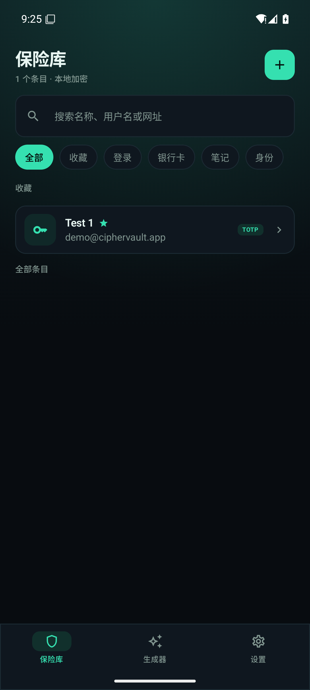

# 密匣 CipherVault

[English](README.en.md) · **简体中文**

[](https://github.com/2373434278/CipherVault/actions/workflows/ci.yml)
[](https://github.com/2373434278/CipherVault/actions/workflows/release.yml)
[](LICENSE)


本地优先的 Android 密码管理器，支持密码保险库、TOTP 动态验证码、密码生成器、生物识别解锁与系统 Autofill。不联网、不上传、不依赖云服务。

UI 采用选型方案 **A · Obsidian Vault（黑曜保险库）**：近黑底、青绿点缀、等宽字体呈现密钥。



## 功能

- 主密码创建与解锁，Argon2id 派生密钥
- 指纹 / 面容解锁（Android Keystore + CryptoObject）
- 登录、银行卡、安全笔记、身份信息四类条目
- 文件夹、收藏、搜索、回收站
- 长按快捷操作：复制用户名 / 密码 / 验证码、置顶、收藏、编辑、移入回收站；列表支持置顶优先等 4 种排序
- TOTP：手动密钥、`otpauth://` URI、二维码扫描；6/8 位、SHA1/256/512、30/60 秒
- 密码安全体检：离线检测弱密码、重复使用、缺少 TOTP
- 密码生成器：随机密码与易记口令
- SQLCipher 全库加密
- 导入/导出：Bitwarden JSON、CSV、自有加密备份
- Android Autofill：用户名、密码、TOTP 填充；锁定状态先认证再填充
- 截屏保护、剪贴板自动清除、自动锁定
- 中英双语，可在设置内切换

> 功能扩展路线图与 v1.1 PRD 见 [docs/PRODUCT-ROADMAP.md](docs/PRODUCT-ROADMAP.md)。

## 下载

前往 [GitHub Releases](https://github.com/2373434278/CipherVault/releases) 下载由 CI 构建的 APK：

| 文件 | 说明 |
| --- | --- |
| `CipherVault-<version>-release.apk` | R8 混淆 + 资源收缩，已签名（仓库配置签名 Secrets 时） |
| `CipherVault-<version>-release-unsigned.apk` | 同上的未签名版本（未配置 Secrets 时） |
| `CipherVault-<version>-debug.apk` | 未混淆 debug 构建，用于开发对比 |
| `CipherVault-<version>-mapping.txt.gz` | Release 的 R8 映射表，用于还原崩溃堆栈 |
| `SHA256SUMS.txt` | 以上 APK 的 SHA-256 校验和 |

> 当前版本未经过第三方安全审计，请自行评估风险后再存放真实凭据。

## 构建

环境要求：JDK 17+（实测 Temurin 21）、Android SDK Platform 36、Build Tools 36.0.0。

```bash
git clone https://github.com/2373434278/CipherVault.git
cd CipherVault

# Debug
./gradlew :app:assembleDebug
adb install -r app/build/outputs/apk/debug/app-debug.apk
```

Release（R8 混淆 + 资源收缩 + v2/v3 签名）：

```bash
./gradlew :app:clean :app:testReleaseUnitTest :app:lintRelease :app:assembleRelease
# 产物：app/build/outputs/apk/release/app-release.apk
```

Release 需要 `keystore.properties`（已被 `.gitignore` 排除）；缺失时构建仍会成功，但产物改名为 `app-release-unsigned.apk` 且不带签名：

```properties
storeFile=../keystore/release.jks
storePassword=<口令>
keyAlias=ciphervault
keyPassword=<口令>
```

生成签名密钥：

```bash
keytool -genkeypair -keystore keystore/release.jks -alias ciphervault \
  -keyalg RSA -keysize 2048 -validity 9125 -dname "CN=CipherVault Release Key"
```

> **必须立刻备份 `keystore/` 与 `keystore.properties`。** 丢失后无法用同一密钥发布升级包，已安装用户只能卸载重装（保险库数据会丢失）。

测试：

```bash
./gradlew :app:testDebugUnitTest :app:testReleaseUnitTest
```

R8 映射表位于 `app/build/outputs/mapping/release/mapping.txt`，线上崩溃堆栈可用 Android SDK 的 `retrace` 工具还原：

```bash
$ANDROID_HOME/cmdline-tools/latest/bin/retrace --mapping mapping.txt crash.log
```

## 自动版本构建

仓库包含两条 GitHub Actions 工作流：

| 工作流 | 触发条件 | 内容 |
| --- | --- | --- |
| [`ci.yml`](.github/workflows/ci.yml) | push 到 `main` / PR | 单元测试、lint、构建 debug APK，并上传产物 |
| [`release.yml`](.github/workflows/release.yml) | 推送 `v*` tag | 用 tag 推导版本号、构建 release/debug APK、生成校验和与 mapping、创建 GitHub Release |

发布新版本：

```bash
git tag v1.1.0
git push origin v1.1.0
```

`versionName` 取自 tag（`1.1.0`），`versionCode` 为 `major*10000 + minor*100 + patch`。也可在本地覆盖：

```bash
./gradlew :app:assembleRelease -Pciphervault.versionName=1.1.0 -Pciphervault.versionCode=10100
```

如需签名包，在仓库 Secrets 中配置 `ANDROID_KEYSTORE_BASE64`、`ANDROID_KEYSTORE_PASSWORD`、`ANDROID_KEY_ALIAS`、`ANDROID_KEY_PASSWORD`，详见 [CONTRIBUTING.md](CONTRIBUTING.md#发布签名可选)。

## 启用 Autofill

1. 打开系统设置 → 系统 → 语言和输入法 → 自动填充服务
2. 选择「密匣自动填充」
3. 在任意支持 Autofill 的应用中点击用户名/密码输入框

锁定状态下，点击「Unlock to autofill」卡片并完成主密码或生物识别认证。返回应用后若填充面板未自动出现，再次点击密码输入框即可选择条目并填充。

匹配规则：条目域名与请求方（网页域名或调用方包名）一致时优先返回；无匹配时回落到收藏条目。因此若面板里没有你想填的条目，把它加入收藏即可。

> Android 16 模拟器上 Credential Manager 会接管 Autofill 选择界面（`dumpsys autofill` 表现为 `Max visible datasets: 0`，即使服务已返回数据集）。验证密匣自身的填充链路可临时关闭该接管：
>
> ```bash
> adb shell device_config put autofill autofill_credman_integration false
> # 恢复默认：adb shell device_config delete autofill autofill_credman_integration
> ```
>
> 这是系统侧显示行为，与密匣无关；真机与 Android 15 及以下不受影响。

仓库内的 `autofill-test` 模块是一个不含真实凭据的测试登录页：

```bash
./gradlew :autofill-test:assembleDebug
adb install -r autofill-test/build/outputs/apk/debug/autofill-test-debug.apk
```

## 安全模型摘要

```
主密码 + salt
  └─ Argon2id (t=3, m=64MiB, p=2, 32B) → KEK
       └─ AES-256-GCM 包裹随机 vaultKey(32B)

vaultKey
  ├─ SQLCipher 数据库口令
  └─ Android Keystore (BIOMETRIC_STRONG) 包裹，用于生物识别解锁
```

更完整的威胁模型、密钥生命周期与已知限制见 [docs/SECURITY.md](docs/SECURITY.md)。

## 项目结构

```
app/                     Android 应用
  src/main/java/com/ciphervault/app/
    crypto/              Argon2id、AES-GCM、Keystore
    data/                Room + SQLCipher、DataStore
    domain/              TOTP、otpauth、生成器、导入导出
    session/             解锁状态与密钥生命周期
    ui/                  Compose 页面与主题
    autofill/            AutofillService 与认证 Activity
  src/test/              JVM 单元测试
autofill-test/           独立 Autofill 验证 App（无真实凭据）
design/                  三套 UI 选型看板与截图
docs/                    安全文档、产品路线图与应用截图
```

## 文档

- [安全模型与威胁分析](docs/SECURITY.md)
- [产品路线图](docs/PRODUCT-ROADMAP.md)
- [贡献指南](CONTRIBUTING.md)

## 致谢

交互与功能范围参考了 Bitwarden、KeePassDX、Aegis Authenticator 等开源项目，但未复制其 GPL 代码。本项目的实现为原创，依赖均为 Apache-2.0 / MIT / BSD 类宽松许可（AndroidX、SQLCipher Community Edition、argon2kt、ZXing）。

## 许可

[Apache License 2.0](LICENSE) © CipherVault contributors
